# Screensaver Studio (`omarchy-screensaver-studio`)

> **Unofficial / Community Plugin**: An independent multi-mode screensaver suite for Omarchy.

A native Wayland screensaver engine with 18 generative visual modes, OLED burn-in prevention, dynamic Omarchy theme synchronization, real-time PipeWire audio spectrum visualization, and full integration with Quickshell's idle monitor and Omarchy launcher menus — running under application ID `org.omarchy.screensaver`.

This project was developed through an AI-assisted workflow. The concept, customization, configuration, testing, integration, and final iteration were directed and carried out by me.

---

## Audio and startup refinement (1.8.1)

Aurora Flow now separates larger track information from the live spectrum, with falling peak caps, low/mid/high band-activity meters and quiet theme-coloured ribbons. Live desktop sound responds even without a named player. Audio listeners share capture safely, and all bar counts span the complete frequency range. The cockpit wakes its seven instruments in sequence, then brings activity and detail panels into view. [Audio Visualizer guide](docs/AUDIO-VISUALIZER.md) · [Telemetry guide](docs/SYSTEM-COCKPIT.md).

## Ambient collection refresh (1.8.0)

The native Screensaver Studio browser lists all 18 modes directly in one searchable menu. Open it with `omarchy-menu-screensaver`, type a name such as Rain or Eclipse, and choose it to apply. The current selection is marked with a check. **Preview Screensavers** opens separate 12-second previews. **Follow Desktop Colours** keeps scenes matched to the active desktop palette. Running screensavers pick up mode, palette and rotation edits within 1.5 seconds without restarting.

New scenes: **Eclipse** (lunar silhouette and solar corona), **Ink Flow** (slow silk filaments), and **Rain on Glass** (night lights and drifting droplets). These inherit the active desktop palette.

Rebuilt Cyber Nexus eliminates accidental filled triangles and an unbounded packet refill loop. Topography now draws nested island contours; Quantum Helix has continuous depth-sorted strands; Celestial Orbit uses matching eccentric guides and time-based trails. Synthwave has opaque terrain silhouettes. Initial allocation and later resizes reach each mode, logical pixel scaling avoids doubled high-DPI effects, the system cockpit fits smaller screens, and long media titles are truncated within the available width.

Existing selected mode, palette, rotation list, ambient controls, audio backend and idle/lock integration are retained during the local upgrade. The default configuration for new installations includes the new scenes in rotation.

Validation: `/usr/bin/python3 -m unittest discover -s tests -v`. These rendering and integration checks require the system PyGObject and Cairo packages.

## My Contribution

I did not write Omarchy, Quickshell, Hyprland, GTK4, or PipeWire from scratch. What I contributed:

- **Plugin Architecture**: Designed and structured this as a conformant Omarchy plugin with `manifest.json` and `BarWidget.qml` following the Omarchy plugin conventions.
- **Python GTK4/Cairo Screensaver Engine**: Designed and implemented the multi-mode screensaver as a native GTK4 Wayland window under application ID `org.omarchy.screensaver` (integrates with Hyprland window rules and Quickshell's `IdleMonitor`). Core modules: `app.py`, `window.py`, `modes/`, `theme.py`, `config.py`.
- **18 Signature Visual Modes**: Authored all visual mode rendering logic:
  - `eclipse`: A lunar silhouette encircled by a softly breathing solar corona.
  - `ink_flow`: Layered silk filaments slowly folding through black space.
  - `rain`: Quiet droplets over distant night lights and reflections.
  - `clock`: Minimalist floating typographic clock with celestial orbital aura, date, and battery status.
  - `matrix`: 3D parallax cybernetic rain with authentic Katakana glyphs, hex numbers, and phosphor decay.
  - `particles`: Volumetric cosmic constellation with wandering gravitational attractor.
  - `warp`: Relativistic 3D starfield hyperspace jump with speed streaks and depth scaling.
  - `geometry`: Hypnotic 4D rotating hypercube (tesseract) with depth cueing and chromatic glow.
  - `singularity`: Kerr rotating black hole with relativistic Doppler-beamed accretion disk.
  - `system`: Digital Cockpit Speedometer Telemetry Cluster — Automotive instrument cluster with precision tachometers (CPU, GPU, RAM), dynamic voltage & amperage badges, dual-trace Bezier 60-second activity sparkline, and an elevated 3-column precision telemetry deck (`ELECTRICAL & POWER` with CPU/GPU/Total SoC/DRAM wattage/volts/amps, `STORAGE & MEMORY I/O` with live NVMe read/write MB/s, IOPS, lifetime transfer totals, and RAM bus bandwidth, and `KERNEL & RUNTIME` with 16-thread queue capacity and load averages).
  - `terminal`: Borderless diagnostic waterfall streaming live Linux kernel and procfs metrics.
  - `visualizer`: Aurora ribbons, live spectrum bars with falling peak caps, low/mid/high activity meters and readable MPRIS track information. See [the Audio Visualizer guide](docs/AUDIO-VISUALIZER.md).
  - `aurora`: Multi-octave harmonic spline ribbons with celestial stardust motes.
  - `cyber_nexus`: Subtle glowing neural nodes connected by pulsing data lines in deep OLED black.
  - `synthwave`: 3D perspective retro wireframe horizon with gentle neon gradient sun.
  - `quantum_helix`: Dual rotating DNA/quantum strands with orbital stardust motes.
  - `topography`: Dynamic topographic contour elevation lines undulating smoothly in dark ambient space.
  - `celestial_orbit`: Gravitational multi-orbital planetary system with planetary trails.
- **OLED Burn-in Protection**: Implemented true `#000000` black subpixel shutoff mode with continuous imperceptible orbital coordinate drift to safeguard OLED/AMOLED displays.
- **Ambient Study Display Mode**: Created dedicated ambient study display toggle with sleep/lock inhibition and touch immunity (shortcut: `SUPER + I`), plus live audio visualizer toggle (`SUPER + T` / `'t'`).
- **Dynamic Palette Synchronizer**: Designed `theme.py` to inherit color schemes dynamically from the active Omarchy `colors.toml` or built-in presets (`aurora`, `cyberpunk`, `matrix`, `minimal`, `osaka`) with 100% theme harmony.
- **Real-Time PipeWire Audio Spectrum Engine**: Native C PipeWire audio monitor (`audio_spectrum.c` compiled into `libomarchy_audio.so`) running at native 48,000 Hz with 64 continuous-frequency Goertzel filters, progressive acoustic tilt equalization and 8–64 display bars spanning the full spectrum (40 Hz - 11.5 kHz), and study mode visualizer toggle (`SUPER + T` / keypress `'t'`).
- **Idle Lifecycle Integration**: Wired `Service.qml` (Quickshell) to trigger the screensaver via `omarchy-launch-screensaver` wrapper and `shell.json` configuration. Wake dismissal (key press, mouse motion, click) cancels idle cycles.
- **Interactive Menu Suite & Extensions**: Designed the floating modal HUD selector (`omarchy-menu-screensaver`), keyboard-driven terminal manager (`omarchy-screensaver-menu` via Gum), CLI state manager (`omarchy-screensaver-select`), and `omarchy-menu-extension.jsonc` for Omarchy application launcher integration.
- **Bar Widget**: Implemented `BarWidget.qml` showing screensaver mode and controls in the Omarchy top bar.
- **Theme Definitions**: Authored `themes/` directory with per-mode color palette overrides.
- **Performance Tuning**: Bounded particle populations, local random generators and mode-specific frame limits; the ambient collection targets 30 FPS. Actual throughput varies with resolution, theme, graphics driver and load.
- **Installer**: Authored `./install.sh` with timestamped backup manifests.
- **Testing**: 33 rendering, selection, theme, audio and telemetry regression checks pass locally. All 18 modes redraw under palette changes; native selection and the updated cockpit recording were checked on the local Hyprland desktop.

---

## Based On / Credits

- **[Omarchy](https://github.com/basecamp/omarchy)** — The open-source Arch Linux desktop environment and plugin system by Basecamp. This plugin uses the Omarchy plugin manifest format, bar widget API, and idle lifecycle integration.
- **[Quickshell](https://quickshell.outfoxxed.me)** — The Qt6 QML Wayland layer-shell desktop shell. `Service.qml` connects to Quickshell's `IdleMonitor` for automatic idle triggering.
- **[Hyprland](https://hyprland.org)** — The Wayland compositor. Window rules target `org.omarchy.screensaver` for fullscreen/float placement.
- **GTK4 / PyGObject / Cairo** — The native Wayland rendering toolkit used for all visual modes.
- **[PipeWire](https://pipewire.org)** — The audio server. The optional audio spectrum engine captures audio via `libpulse-simple` from PipeWire's PulseAudio compatibility layer.

**Related Repos**:
- [omarchy-system-pulse](https://github.com/aarushdalal/omarchy-system-pulse) — System telemetry and audio dashboard
- [omarchy-focus-hub](https://github.com/aarushdalal/omarchy-focus-hub) — Pomodoro and focus session manager
- [omarchy-aesthetic-themes](https://github.com/aarushdalal/omarchy-aesthetic-themes) — Anime color themes (palettes used by screensaver)

---

## Plugin Manifest

This repository includes a valid `manifest.json` for the Omarchy plugin system:

```json
{
  "schemaVersion": 1,
  "id": "daemon0.screensaver-studio",
  "name": "Screensaver Studio",
  "version": "1.8.1",
  "author": "Daemon0",
  "description": "18-mode screensaver suite (clock, matrix, particles, warp, geometry, singularity, terminal, system, visualizer, aurora, cyber_nexus, synthwave, quantum_helix, topography, celestial_orbit, eclipse, ink_flow, rain) with sub-second startup, low resource overhead, Quickshell, audio spectrum, and menu integration",
  "kinds": ["bar-widget"],
  "entryPoints": { "barWidget": "BarWidget.qml" },
  "barWidget": {
    "displayName": "Screensaver Studio",
    "category": "Desktop",
    "allowMultiple": false,
    "defaultSection": "right"
  }
}
```

---

## Status / Experimental Warning

This project contains native Python GTK4 rendering code and optional C extensions. **Pre-compiled binary objects (`.so`) are excluded from the public repository.** Build tools (`gcc`, `libpulse`) are required only if you want real-time audio reactivity. Framerate, rendering overhead, and battery consumption vary by GPU driver and CPU architecture.

---

## Features

- **Sub-Second Latency & Low Resource Consumption**: Instant startup ($\le 0.45$s) using deferred background subsystem initialization and optimized lightweight rendering loops.
- **18 Signature Visual Modes**:
  - `eclipse`: A lunar silhouette encircled by a softly breathing solar corona.
  - `ink_flow`: Layered silk filaments slowly folding through black space.
  - `rain`: Quiet droplets over distant night lights and reflections.
  - `clock`: Minimal typographic clock with orbital aura
  - `matrix`: 3D Katakana & hex cybernetic cascading rain with glyph caching
  - `particles`: Volumetric constellation network with wandering attractor (clamped to 90 particles for low CPU load)
  - `warp`: Relativistic starfield warp with perspective streaks (300 stars)
  - `geometry`: 4D rotating hypercube (tesseract) with depth cueing
  - `singularity`: Kerr black hole with Doppler-beamed accretion disk (220 particles)
  - `terminal`: Borderless holographic diagnostic stream
  - `system`: Digital Cockpit Speedometer Telemetry Cluster — Automotive tachometers, live CPU/GPU/SoC/DRAM electrical rails (W, V, A), real-time NVMe read/write speeds, IOPS, and lifetime stats, memory bus bandwidth (GB/s), and 16-thread run queue capacity
  - `visualizer`: Real-time PipeWire audio spectrum & MPRIS metadata
  - `aurora`: Harmonic Perlin spline ribbons with stardust motes (20 FPS smooth flow)
  - `cyber_nexus`: Subtle glowing neural nodes connected by pulsing data lines in deep OLED black
  - `synthwave`: 3D perspective retro wireframe horizon with gentle neon gradient sun
  - `quantum_helix`: Dual rotating DNA/quantum strands with orbital stardust motes
  - `topography`: Dynamic topographic contour elevation lines undulating smoothly in dark ambient space
  - `celestial_orbit`: Gravitational multi-orbital planetary system with planetary trails
- **OLED True-Black Mode**: `#000000` subpixel shutoff with continuous micro-drift protection
- **Dual-OS Integration**: Unified controls and synchronized launcher menus across both Omarchy and DaemonOS (`SUPER + CTRL + I` and `SUPER + I`)
- **Dynamic Palette Synchronizer**: Inherits color schemes from the active Omarchy theme (`colors.toml`) or built-in presets
- **Interactive Floating HUD**: `omarchy-menu-screensaver` modal menu and top-bar integration
- **Terminal TUI Manager**: `omarchy-screensaver-menu` powered by Gum
- **Omarchy Menu Integration**: Bundled `omarchy-menu-extension.jsonc` adds direct screensaver controls into Omarchy launcher menus
- **Idle Lifecycle Integration**: App ID `org.omarchy.screensaver` — integrates with Quickshell idle services, dismisses instantly on input
- **Real-Time Audio Spectrum**: Optional C/PipeWire backend with 36 Goertzel filters, sub-10ms latency

### System Cockpit in 1.8.0

The system display now puts the most useful readings first, with larger text and seven animated gauges. On launch, a labelled car-style instrument check starts CPU, graphics and memory in sequence, then temperature, storage, load and battery. Each needle sweeps to 100, returns to zero, then hands over to real utilization. Activity and detail panels fade in as later components:

1. **Core load:** CPU, GPU and memory utilization. Smooth needles follow the readings; a separate outer marker holds the recent peak. Per-core activity, VRAM and swap bars sit below the main instruments.
2. **Capacity and thermals:** CPU temperature, root-storage usage, normalized one-minute load and battery charge. The temperature instrument uses a labelled 0–100°C display scale. Unsupported sensors show N/A.
3. **Activity:** separate processor and network histories, with solid/dashed traces that remain distinguishable in monochrome themes, pulsing live endpoints and a subtle moving scan line.
4. **Details:** power/electrical readings; today’s disk reads/writes; lifetime NVMe reads, writes, I/O-command snapshot and estimated endurance; current disk throughput/IOPS; memory activity; and kernel, tasks, governor, uptime and Linux resource pressure.

Per-core activity comes from successive `/proc/stat` samples. Pressure readings use `some avg10` from `/proc/pressure`: the percentage of the preceding ten seconds in which at least one task was stalled. The load/capacity gauge divides one-minute load average by logical CPU count; it is not CPU utilization. Network rates aggregate non-loopback interfaces and use an explicitly labelled automatic graph scale.

CPU/GPU power allocation and DRAM values are estimates and are labelled **est.** A readable hardware power sensor is shown separately. **VM page flow** describes allocation/free-page activity; it is not a measured physical memory-bus benchmark. Missing pressure/temperature sensors remain unavailable rather than inventing readings.

Rendering targets 30 FPS with bounded drawing work, while metrics are sampled about twice a second. Actual throughput depends on hardware, resolution and load. The layout scales together to preserve its hierarchy on smaller displays. All accents and highlights follow the active palette. See [the full cockpit field and layout guide](docs/SYSTEM-COCKPIT.md), including daily-total coverage, the optional SMART snapshot refresh and what **PRESSURE 10s / PSI** means.

---

## Showcase Gallery

**18 recorded previews.** System Cockpit and Audio Visualizer are refreshed for version 1.8.1. Click an animated preview or **Watch video** to open its player. The three new scenes appear first.

| Screensaver | Animated preview | Description |
|---|---|---|
| Eclipse · **New** | [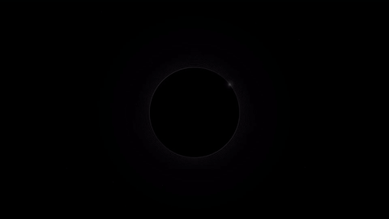](https://aarushdalal.github.io/omarchy-screensaver-studio/#eclipse)<br>[Watch video](https://aarushdalal.github.io/omarchy-screensaver-studio/#eclipse) | A lunar silhouette with a breathing solar corona |
| Ink Flow · **New** | [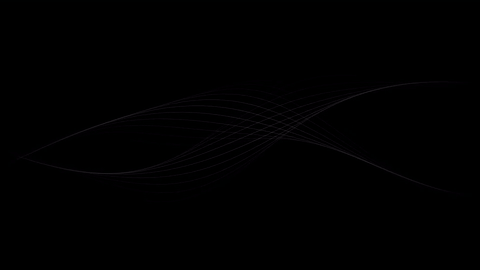](https://aarushdalal.github.io/omarchy-screensaver-studio/#ink_flow)<br>[Watch video](https://aarushdalal.github.io/omarchy-screensaver-studio/#ink_flow) | Layered silk filaments folding through darkness |
| Rain on Glass · **New** | [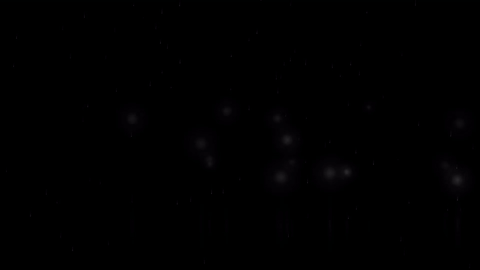](https://aarushdalal.github.io/omarchy-screensaver-studio/#rain)<br>[Watch video](https://aarushdalal.github.io/omarchy-screensaver-studio/#rain) | Quiet droplets, soft night lights and reflections |
| Floating Clock | [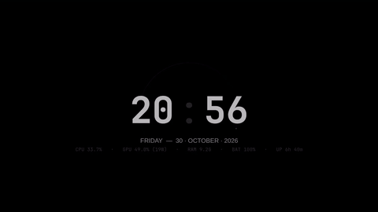](https://aarushdalal.github.io/omarchy-screensaver-studio/#clock)<br>[Watch video](https://aarushdalal.github.io/omarchy-screensaver-studio/#clock) | Clean typography, orbital halo and date |
| Aurora | [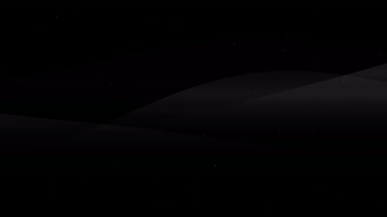](https://aarushdalal.github.io/omarchy-screensaver-studio/#aurora)<br>[Watch video](https://aarushdalal.github.io/omarchy-screensaver-studio/#aurora) | Slow luminous ribbons and drifting stardust |
| Topography | [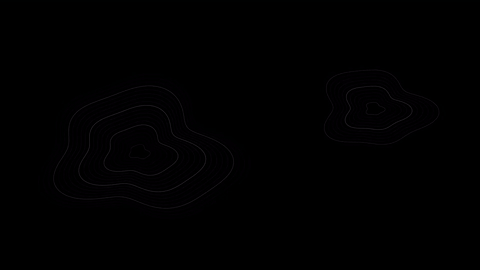](https://aarushdalal.github.io/omarchy-screensaver-studio/#topography)<br>[Watch video](https://aarushdalal.github.io/omarchy-screensaver-studio/#topography) | Living islands traced by nested contour lines |
| Celestial Orbit | [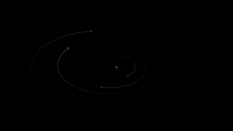](https://aarushdalal.github.io/omarchy-screensaver-studio/#celestial_orbit)<br>[Watch video](https://aarushdalal.github.io/omarchy-screensaver-studio/#celestial_orbit) | Elliptical planetary paths and fading trails |
| Singularity | [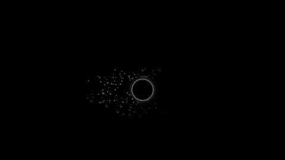](https://aarushdalal.github.io/omarchy-screensaver-studio/#singularity)<br>[Watch video](https://aarushdalal.github.io/omarchy-screensaver-studio/#singularity) | A dark core surrounded by swirling matter |
| Tesseract | [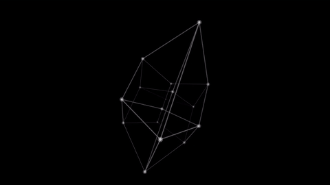](https://aarushdalal.github.io/omarchy-screensaver-studio/#geometry)<br>[Watch video](https://aarushdalal.github.io/omarchy-screensaver-studio/#geometry) | A rotating four-dimensional wireframe |
| Quantum Helix | [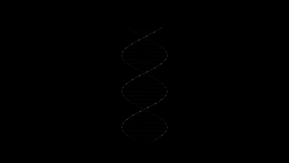](https://aarushdalal.github.io/omarchy-screensaver-studio/#quantum_helix)<br>[Watch video](https://aarushdalal.github.io/omarchy-screensaver-studio/#quantum_helix) | Continuous double strands with depth and dust |
| Constellation | [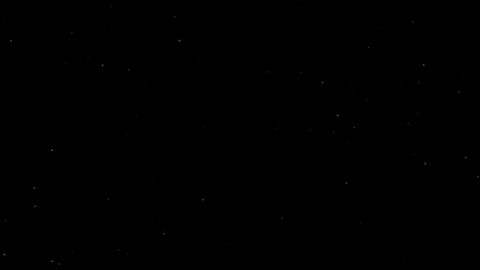](https://aarushdalal.github.io/omarchy-screensaver-studio/#particles)<br>[Watch video](https://aarushdalal.github.io/omarchy-screensaver-studio/#particles) | Drifting particles joined by delicate filaments |
| Starfield Warp | [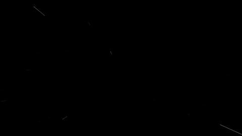](https://aarushdalal.github.io/omarchy-screensaver-studio/#warp)<br>[Watch video](https://aarushdalal.github.io/omarchy-screensaver-studio/#warp) | Perspective stars and flowing light trails |
| Synthwave Horizon | [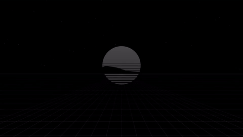](https://aarushdalal.github.io/omarchy-screensaver-studio/#synthwave)<br>[Watch video](https://aarushdalal.github.io/omarchy-screensaver-studio/#synthwave) | A distant striped sun over a wireframe landscape |
| Cyber Nexus | [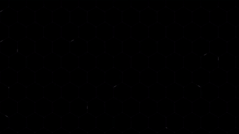](https://aarushdalal.github.io/omarchy-screensaver-studio/#cyber_nexus)<br>[Watch video](https://aarushdalal.github.io/omarchy-screensaver-studio/#cyber_nexus) | Honeycomb circuitry with travelling signals |
| Matrix Rain | [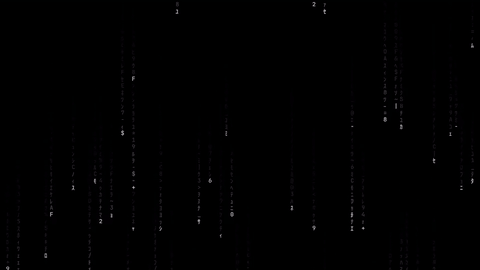](https://aarushdalal.github.io/omarchy-screensaver-studio/#matrix)<br>[Watch video](https://aarushdalal.github.io/omarchy-screensaver-studio/#matrix) | Cascading Katakana and phosphor trails |
| Audio Visualizer | [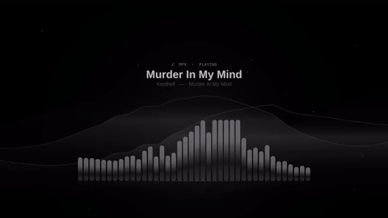](https://aarushdalal.github.io/omarchy-screensaver-studio/#visualizer)<br>[Watch video](https://aarushdalal.github.io/omarchy-screensaver-studio/#visualizer) | Live spectrum, falling peaks and low/mid/high activity |
| System Cockpit | [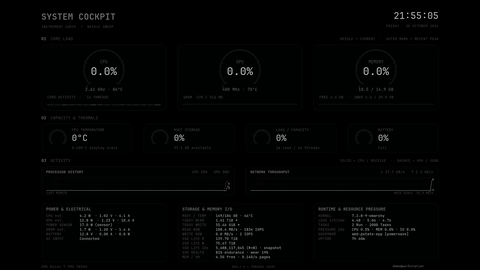](https://aarushdalal.github.io/omarchy-screensaver-studio/#system)<br>[Watch video](https://aarushdalal.github.io/omarchy-screensaver-studio/#system) | Staggered gauge startup and daily/lifetime SSD telemetry |
| Diagnostic Stream | [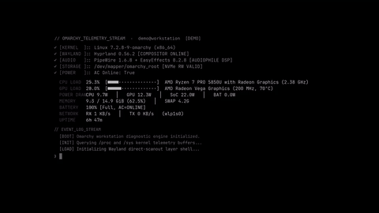](https://aarushdalal.github.io/omarchy-screensaver-studio/#terminal)<br>[Watch video](https://aarushdalal.github.io/omarchy-screensaver-studio/#terminal) | A borderless stream of system activity |

The System Cockpit clip shows the new seven-gauge dashboard, per-core activity, processor/network histories and resource pressure. All videos are silent; workstation identity is replaced with demo labels in the telemetry clips. See [recording details](docs/SHOWCASE.md).

---

## Requirements

- **Operating System**: Arch Linux (rolling release, x86_64)
- **Desktop Shell**: Omarchy (`dev (13f18b2c) / 4.0.2`) with Quickshell (`0.3.1`)
- **Compositor**: Hyprland (`0.56.2`)
- **Runtime Dependencies**: `python3`, `gtk4`, `python-gobject`, `cairo`, `jq`
- **Optional (for Audio Spectrum)**: `pipewire-pulse`, `libpulse`, `gcc`
- **Optional (for Terminal TUI)**: `gum`

---

## Compatibility

| Component | Tested Version | Compatibility Status |
|---|---|---|
| Omarchy | `dev (13f18b2c) / 4.0.2` | Fully compatible |
| Quickshell | `0.3.1` | Fully compatible |
| Hyprland | `0.56.2` | Fully compatible |
| GTK | GTK4 Wayland | Fully compatible |

---

## Installation

### Method 1: Using Omarchy Plugin Manager (Recommended)

```bash
omarchy plugin add https://github.com/aarushdalal/omarchy-screensaver-studio.git --enable
```

### Method 2: Using the Safe User Installer

```bash
git clone https://github.com/aarushdalal/omarchy-screensaver-studio.git
cd omarchy-screensaver-studio

./install.sh check
./install.sh install --dry-run
./install.sh install
```

---

## System Setup Before Installation

1. Install GTK4 PyGObject dependencies:
   ```bash
   sudo pacman -S gtk4 python-gobject cairo jq
   ```
2. Optional — audio development headers for the spectrum visualizer:
   ```bash
   sudo pacman -S libpulse base-devel
   ```
3. Optional — terminal TUI manager:
   ```bash
   sudo pacman -S gum
   ```

---

## Configuration Guide

See [**docs/CONFIGURATION.md**](docs/CONFIGURATION.md) for detailed per-mode TOML parameter specifications, theme overrides, and OLED settings.

---

## Usage

- **Preview Any Mode for 5 Seconds**:
  ```bash
  omarchy-screensaver-preview matrix 5
  omarchy-screensaver-preview warp 5
  omarchy-screensaver-preview geometry 5
  omarchy-screensaver-preview singularity 5
  ```
- **Open Interactive Mode HUD**:
  ```bash
  omarchy-menu-screensaver
  ```
- **Open Terminal TUI Manager**:
  ```bash
  omarchy-screensaver-menu
  ```
- **Switch Default Mode**:
  ```bash
  omarchy-screensaver-select mode singularity
  ```
- **Toggle Ambient Study Display**:
  ```bash
  omarchy-screensaver-toggle
  ```

---

## Update

```bash
omarchy plugin update daemon0.screensaver-studio
```

---

## Uninstall

```bash
./install.sh uninstall
# Or:
omarchy plugin remove daemon0.screensaver-studio --yes
```

---

## Security and Privacy

- No external network requests are made.
- Audio capture (if enabled) analyzes local frequency amplitudes only and never records, stores, or transmits audio streams.

---

## Contributing

Contributions are welcome!

---

## License

[MIT License](LICENSE).

---

## Credits / Third-Party Notices

- Built for the [Omarchy](https://github.com/basecamp/omarchy) desktop environment.
- Powered by [Quickshell](https://quickshell.outfoxxed.me/), [Hyprland](https://hyprland.org/), GTK4, and [PipeWire](https://pipewire.org/).
- Not an official Omarchy product.

## Refinement and privacy update

Ambient motion · optional telemetry · private previews. The showcase gallery includes reviewed recordings; see [release privacy](docs/RELEASE-PRIVACY.md). Existing Git history is preserved.
